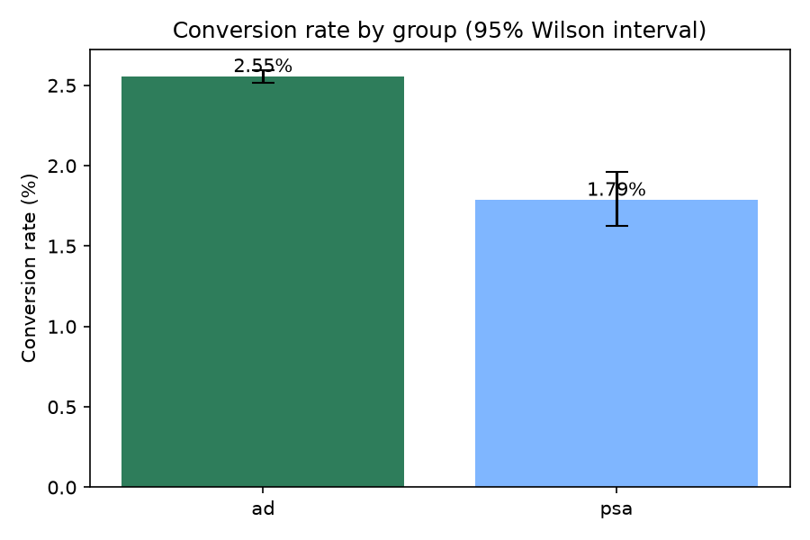
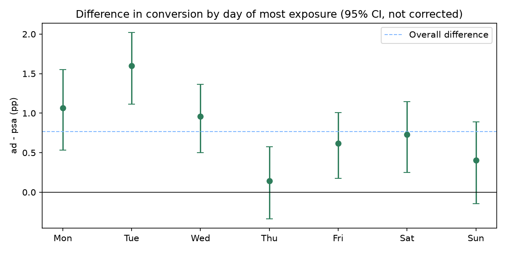

# Marketing A/B Test Analysis

Did showing an advertisement increase conversion compared with a public service announcement (PSA), and was the experiment large enough to tell? A two-proportion z-test in Python, with power analysis and multiple-testing correction, reconciled independently in Excel.

## Result

|                    | Users   | Conversions | Conversion rate |
|--------------------|--------:|------------:|----------------:|
| **ad** (treatment) | 564,577 | 14,423      | 2.55%           |
| **psa** (control)  | 23,524  | 420         | 1.79%           |



- **Difference: +0.77 percentage points** (95% CI: 0.59 to 0.94 pp).
- **Relative lift: +43%** (95% CI: +30% to +57%).
- Two-proportion z-test: z = 7.37, p < 0.001. Cohen's h = 0.053 (small in standardized terms, meaningful for a conversion metric).
- **Power:** the smallest effect detectable with 80% power is 0.26 pp (14% relative), about one third of the observed difference.
- **By weekday of heaviest exposure (exploratory):** the difference is positive every day and significant after Holm correction on 5 of 7 (Mon, Tue, Wed, Fri, Sat). Thursday and Sunday are not significant, but each has only about 3,000 control users, so this is not evidence of no effect. Whether the effect actually varies is a separate question, answered by an interaction test rather than by comparing which days are significant: a likelihood-ratio test of group x segment gives p = 0.013 by weekday (6 df) and p = 0.013 by four bands of the day (3 df), so the data do suggest the effect is not uniform. Because these segments are post-assignment variables, that variation may reflect who is exposed when rather than a different effect of the ad, which makes it a hypothesis for a follow-up experiment.
- **By hour of heaviest exposure (exploratory):** positive in 21 of 22 hours tested and significant after correction in only one (14:00), consistent with chance given 29 segment tests. Six hours with very few control conversions use Fisher's exact test instead of the z-test.
- **Exposure (descriptive):** conversion rises steeply with the number of ads seen, and the gap between `ad` and `psa` is concentrated in the highest exposure quintile (9.8% vs 6.0%); in the lower quintiles the groups are close or reversed.



The day, hour and exposure variables are all measured *after* users enter the experiment, so the treatment can affect them. These breakdowns are hypotheses for a follow-up experiment, not targeting rules and not clean subgroup effects.

**Conclusion:** the ad outperforms the PSA on conversion, and the evidence is strong for the overall effect. A causal reading assumes users were randomly assigned, which cannot be verified here.

## Excel reconciliation

`excel/ab_test_excel_check.xlsx` recomputes the test with spreadsheet formulas (`SUMIFS`, standard-error and z formulas) and compares each value with the notebook output. All checks match.

| Metric                | Excel              | Python             | Match |
|-----------------------|-------------------:|-------------------:|:-----:|
| Difference (ad - psa) | 0.7692%            | 0.7692%            | OK    |
| Std. error (pooled)   | 0.10437%           | 0.10437%           | OK    |
| z                     | 7.3701             | 7.3701             | OK    |
| p-value               | 1.71e-13           | 1.71e-13           | OK    |
| 95% CI (Wald)         | 0.5951% to 0.9434% | 0.5951% to 0.9434% | OK    |
| Relative lift         | 43.09%             | 43.09%             | OK    |

The notebook also reports an Agresti-Caffo interval from `statsmodels` (0.591 to 0.940 pp), which differs slightly from the Wald interval used in Excel (the Wald critical value is `NORMSINV(0.975)` in the sheet, matching the notebook). The interval for the relative lift uses the log-adjusted method from `statsmodels`.

## Method

1. **Data checks** with assertions: valid group labels, binary outcome, no missing values, no user in both groups.
2. **Main test:** pooled two-proportion z-test (by hand and with `statsmodels`), Wald and Agresti-Caffo intervals, relative lift with its interval, Cohen's h.
3. **Power analysis:** minimum detectable effect at 80% power (`NormalIndPower`). A sample size computed from the observed effect is deliberately not reported, since it is circular.
4. **Segments:** tests by weekday and hour of heaviest exposure, skipping segments with fewer than 30 users in either group, with Holm correction applied within each family. Fisher's exact test replaces the z-test where the expected control conversions are below 5.
5. **Interaction test:** likelihood-ratio test of group x segment (weekday, and four bands of the day) in a logistic model, to check whether the effect varies at all.
6. **Exposure (`total_ads`):** descriptive only, since it is measured after assignment and can be affected by the treatment.

## Limitations

- **Undocumented origin.** The dataset's author does not say whether it is real or simulated, so this is a methodological exercise, not evidence about a real campaign.
- **Unknown planned split.** The allocation is about 96% `ad` and 4% `psa`, but the planned allocation is not documented, so a sample-ratio check was not possible.
- **Post-assignment variables.** `most_ads_day`, `most_ads_hour` and `total_ads` are measured after users enter the experiment and can be affected by the treatment, so every segment and exposure comparison is descriptive.
- **Strong imbalance.** The test is well powered overall, but segment-level results rest on small control samples; overnight hours have no control conversions, so their estimates are unstable.
- **Multiple comparisons.** Holm correction is applied separately to weekdays (7 tests) and hours (22 tests), not across all 29, and the segment analysis was not pre-specified.
- **One outcome only.** Conversion is measured, but not revenue, ad cost or long-term effects.

## How to reproduce

```
python -m venv .venv
pip install -r requirements.txt
jupyter notebook
```

Activate the environment first: `source .venv/bin/activate` on Linux/macOS, `.venv\Scripts\activate` on Windows (cmd) or `.venv\Scripts\Activate.ps1` on Windows (PowerShell).

1. Download `marketing_AB.csv` from Kaggle and place it in `data/raw/`.
2. Start Jupyter from the activated environment (`jupyter notebook`), open `notebooks/01_ab_test_analysis.ipynb` and run all cells. It writes three CSVs to `data/processed/` and two charts to `figures/`.
3. Open `excel/ab_test_excel_check.xlsx` to see the reconciliation.

## Dataset

[Marketing A/B Testing](https://www.kaggle.com/datasets/faviovaz/marketing-ab-testing) on Kaggle, listed under the CC0 (public domain) license. The raw file is not included in this repository.

## Project structure

```
marketing-ab-test-analysis/
├── data/
│   ├── raw/                  # marketing_AB.csv (not tracked)
│   └── processed/            # CSVs written by the notebook
├── notebooks/
│   └── 01_ab_test_analysis.ipynb
├── excel/
│   └── ab_test_excel_check.xlsx
├── figures/                  # charts written by the notebook
├── .gitignore
├── LICENSE
├── README.md
└── requirements.txt
```

## Tools

Python (pandas, numpy, matplotlib, statsmodels, scipy), Excel/LibreOffice (formulas and reconciliation).
